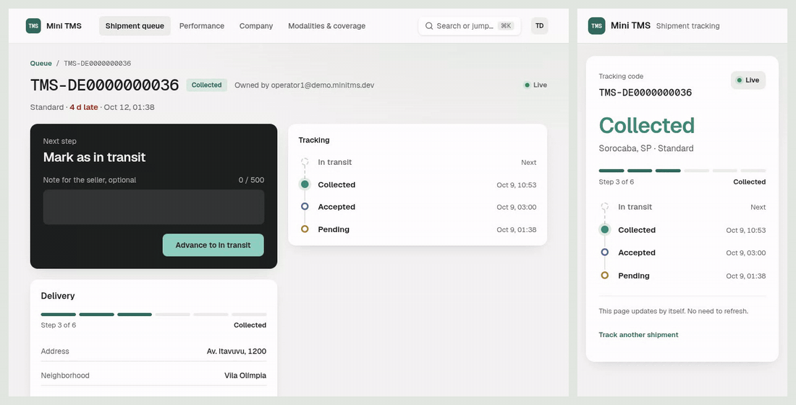
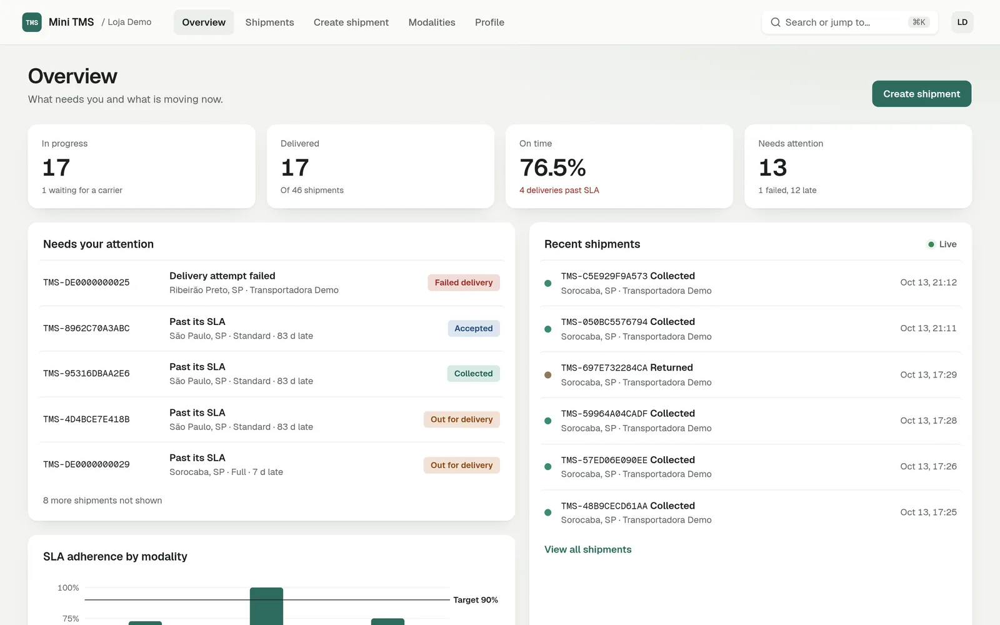
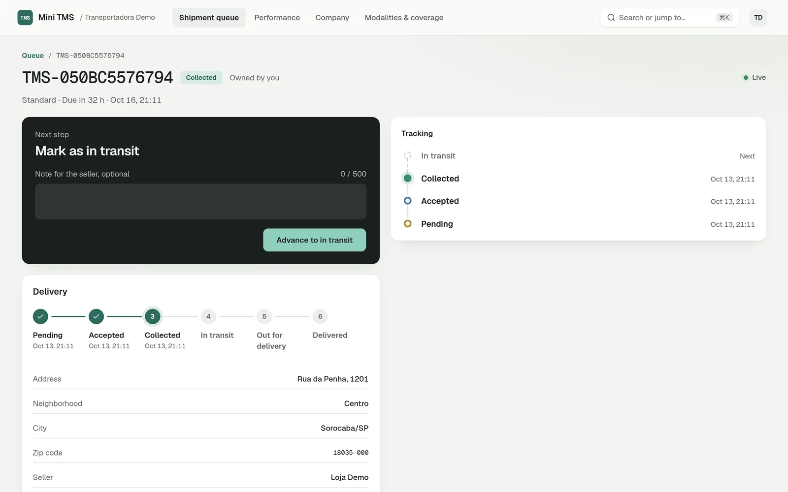
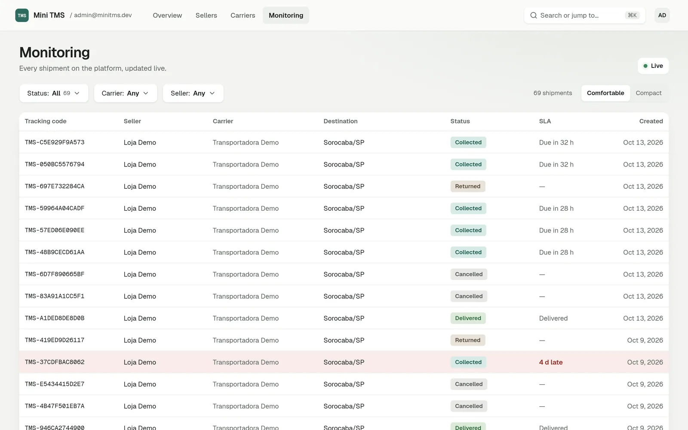
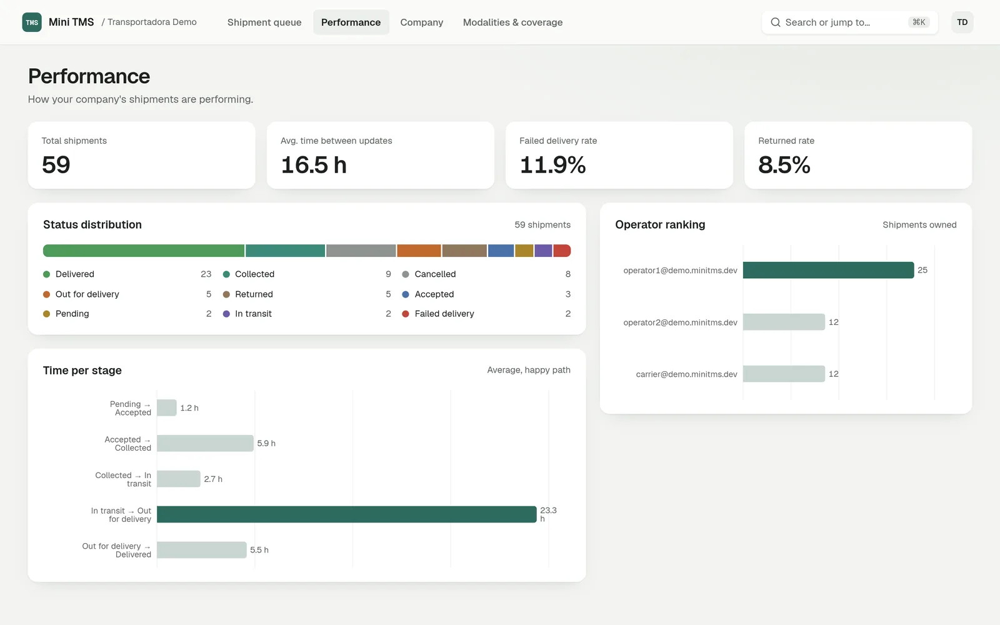
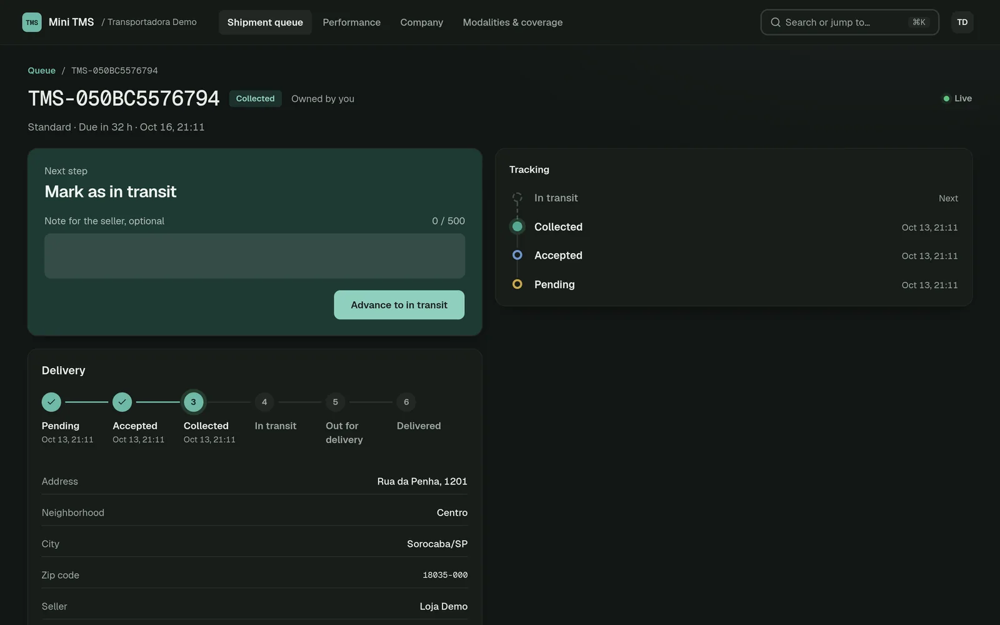
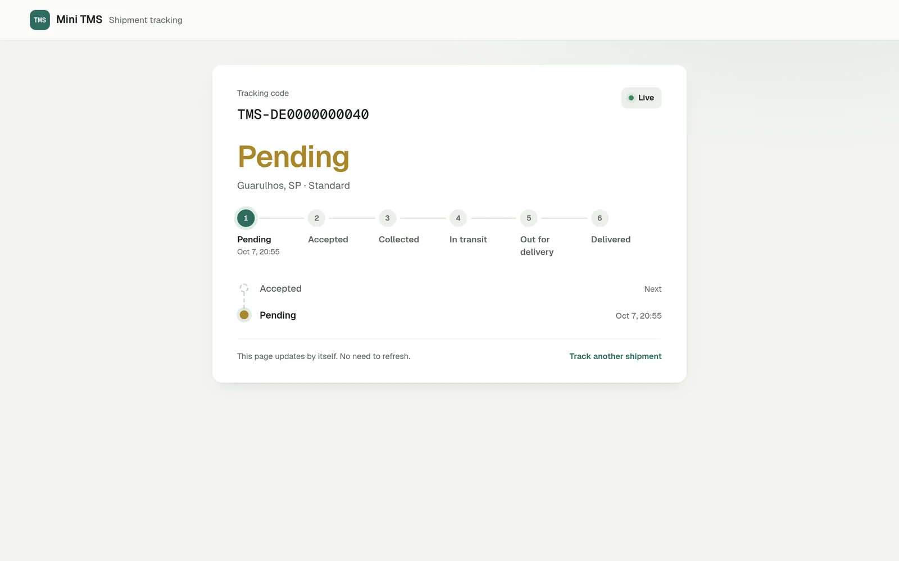
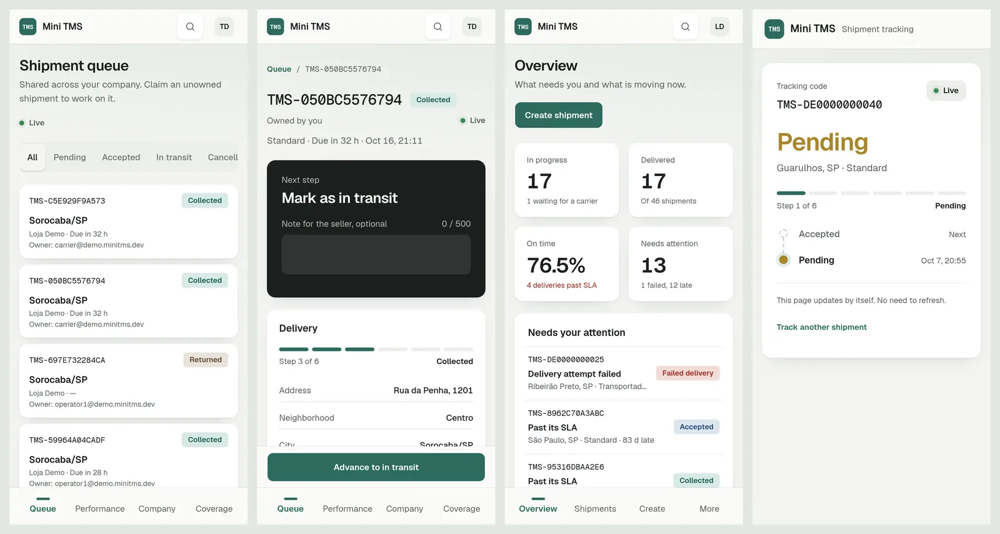
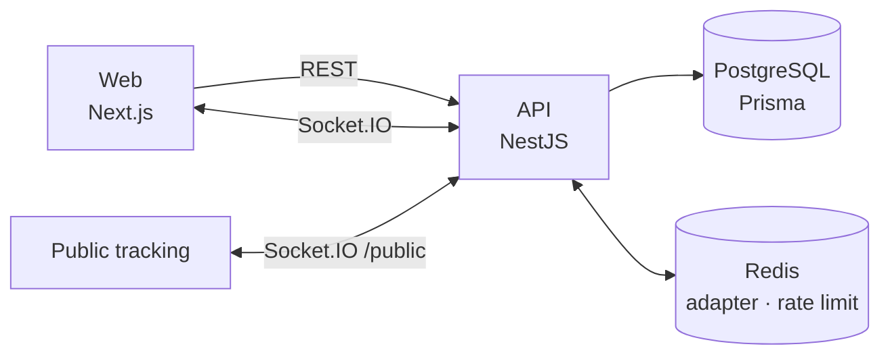

# Mini TMS

[](https://github.com/MGuerreiro42/mini-tms-logitrack/actions/workflows/ci-api.yml)
[](https://github.com/MGuerreiro42/mini-tms-logitrack/actions/workflows/ci-web.yml)
[](./LICENSE)

Multi-tenant transportation management system. Sellers ship, carriers deliver, and everyone, including the end customer, follows each shipment live.



<sub>A carrier advances a shipment (left); the public tracking page (right) updates with no refresh.</sub>

## Features

**Sellers**
- Create shipments in three steps: destination and modality, a carrier that covers it, review
- Home focused on what needs attention: failed deliveries and shipments past their SLA, plus a live activity feed
- Shipment list with status filters, SLA column and comfortable/compact density; cancel before pickup

**Carriers**
- Shared queue: operators claim shipments and move them step by step, with notes for the seller
- Failed delivery and return flows behind confirmation
- Performance: status distribution, time per stage, operator ranking
- Own coverage areas (whole states or specific cities) and modalities

**Admins**
- Approve or reject seller and carrier sign-ups
- Platform-wide monitoring, filterable by status, seller and carrier, updated live

**Everyone**
- Public tracking page per shipment, live over WebSocket
- `⌘K` command menu (pages and tracking codes), light and dark themes, full mobile layout

## Screenshots

<table>
  <tr>
    <td></td>
    <td></td>
  </tr>
  <tr>
    <td align="center"><sub>Seller overview</sub></td>
    <td align="center"><sub>Carrier shipment detail</sub></td>
  </tr>
  <tr>
    <td></td>
    <td></td>
  </tr>
  <tr>
    <td align="center"><sub>Admin monitoring</sub></td>
    <td align="center"><sub>Carrier performance</sub></td>
  </tr>
  <tr>
    <td></td>
    <td></td>
  </tr>
  <tr>
    <td align="center"><sub>Dark theme</sub></td>
    <td align="center"><sub>Public tracking</sub></td>
  </tr>
</table>



## Architecture



- **Multi-tenant RBAC** in layers: global role, company membership (manager/operator) and per-resource ownership, enforced in guards and queries.
- **Carrier matching:** a shipment can only go to an approved carrier that covers the destination city or state and offers the chosen modality.
- **Real-time:** status changes fan out to seller, carrier and shipment rooms. The Socket.IO Redis adapter keeps it correct across multiple API instances; public tracking runs on its own unauthenticated namespace.
- **SLA** derived from creation time and modality (`dueAt`), no extra state to keep in sync.

The reasoning behind each decision is in [`DESIGN.md`](./DESIGN.md).

## Tech stack

| | |
|---|---|
| **API** | NestJS 11, Prisma 7, PostgreSQL 16, Redis 7, Socket.IO, JWT |
| **Web** | Next.js 16 (App Router), React 19, TanStack Query, Tailwind CSS 4, shadcn/ui, Recharts |
| **Testing** | Vitest (unit + e2e on real Postgres and Redis), Testing Library, MSW |
| **Tooling** | pnpm, Biome, lefthook, commitlint, GitHub Actions (CI, CodeQL, gitleaks) |

## Getting started

Requires Node 24, pnpm 11 and Docker.

```bash
pnpm install                       # root: git hooks only
docker compose up -d               # Postgres + Redis

cd apps/api
cp .env.example .env               # matches docker-compose; seeds the demo data
pnpm install
pnpm exec prisma migrate deploy
pnpm exec prisma db seed
pnpm start:dev                     # http://localhost:3333

cd ../web
cp .env.example .env.local
pnpm install
pnpm dev                           # http://localhost:3000
```

Demo accounts (local seed only):

| Role | Email | Password |
|---|---|---|
| Seller | `seller@demo.minitms.dev` | `demo12345` |
| Carrier manager | `carrier@demo.minitms.dev` | `demo12345` |
| Carrier operator | `operator1@demo.minitms.dev` | `demo12345` |
| Admin | `admin@minitms.dev` | `admin12345` |

Tracking codes like `TMS-DE0000000040` open at `/track/<code>` without signing in.

## Testing

```bash
# apps/api
pnpm test          # unit
pnpm test:e2e      # needs E2E_DATABASE_URL pointing at a database ending in _e2e

# apps/web
pnpm test
```

CI runs lint, build and tests for both apps on every pull request, with real Postgres and Redis for the API e2e suite.

## Deployment

- **Web** on Vercel: root directory `apps/web`, `NEXT_PUBLIC_API_URL` set to the API.
- **API** on Railway: root directory `apps/api`. WebSockets need a long-running process, so not serverless. Build, start, healthcheck and pre-deploy (migrations + seed) are versioned in `apps/api/railway.json`. Per environment: Postgres and Redis add-ons, `JWT_SECRET`, `CORS_ORIGIN`, `TRUST_PROXY` (number of proxies in front of the API; required in production) and `ADMIN_PASSWORD`. `SEED_DEMO=true` only where the public demo accounts belong.

## Project structure

```
apps/
├── api/   NestJS: modules per domain (auth, sellers, carriers, shipments, tracking…)
└── web/   Next.js: app routes, feature folders, shared components
```

The two apps are independent pnpm projects. Open [`mini-tms.code-workspace`](./mini-tms.code-workspace) in VS Code so each resolves its own `tsconfig.json`.

More docs: [`DESIGN.md`](./DESIGN.md) (architecture, data model, decisions), [`SCREENS.md`](./SCREENS.md) (screen specs), [`FLOW.md`](./FLOW.md) (end-to-end flow).

## Roadmap

Operator invites, email and SLA-breach notifications, rule-based assignment. See [`DESIGN.md` § 7](./DESIGN.md#7-roadmap-advanced-features--next-steps).

## License

[MIT](./LICENSE)
