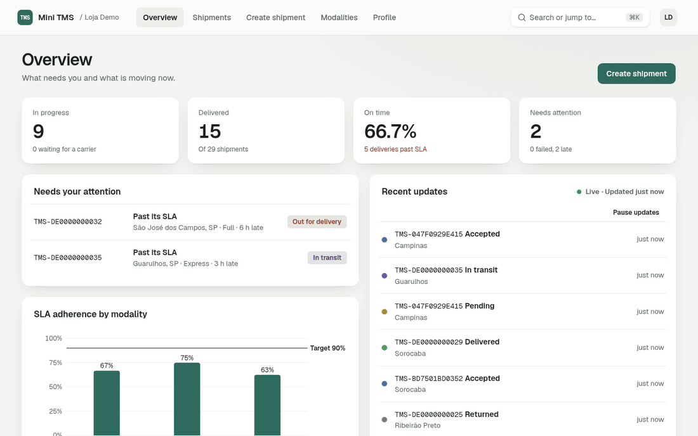
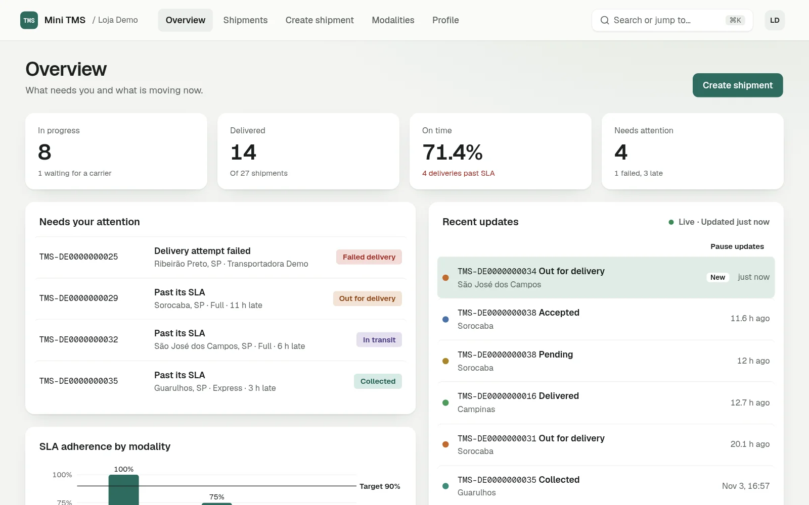
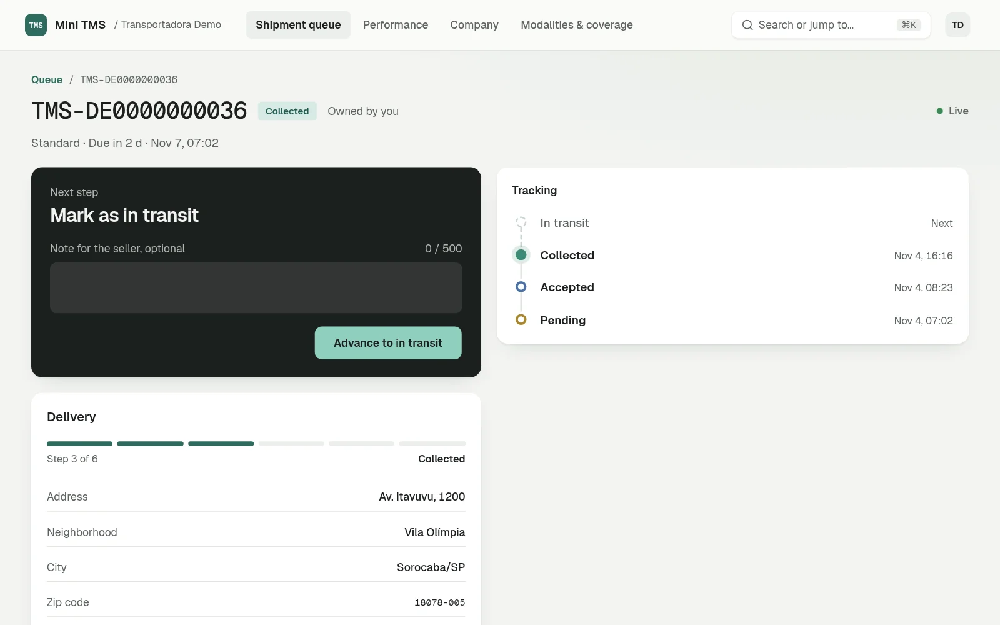
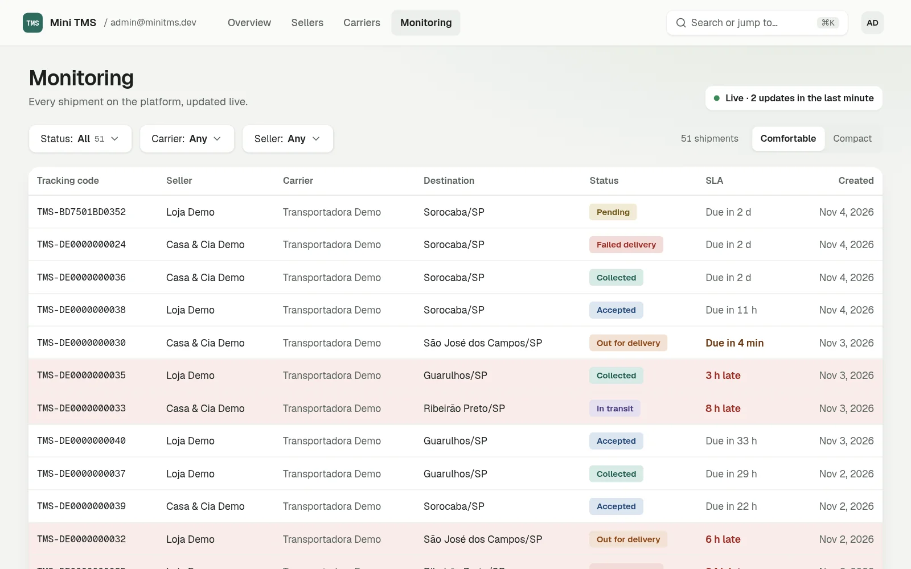
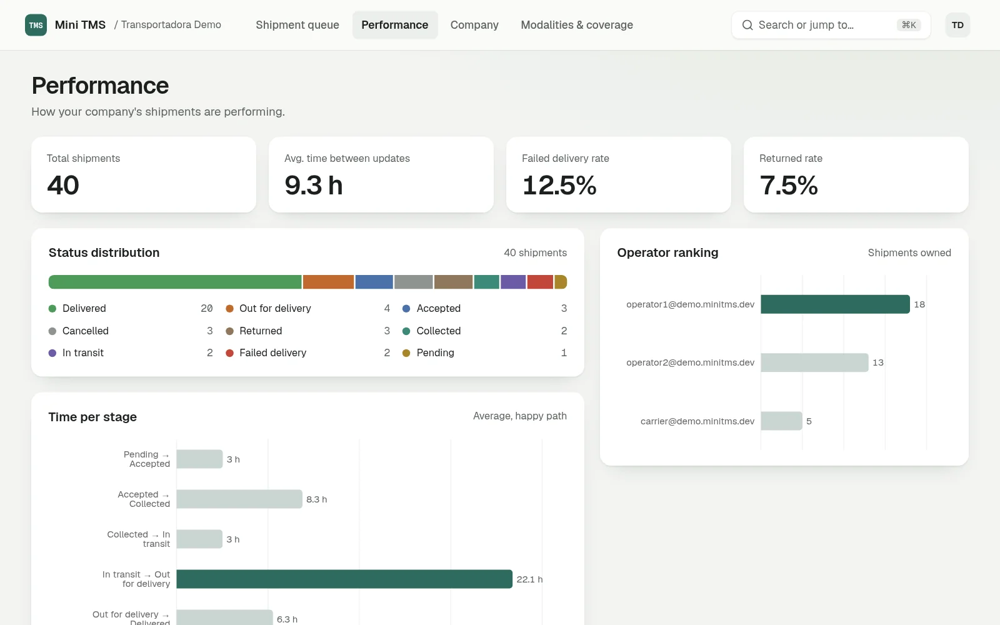
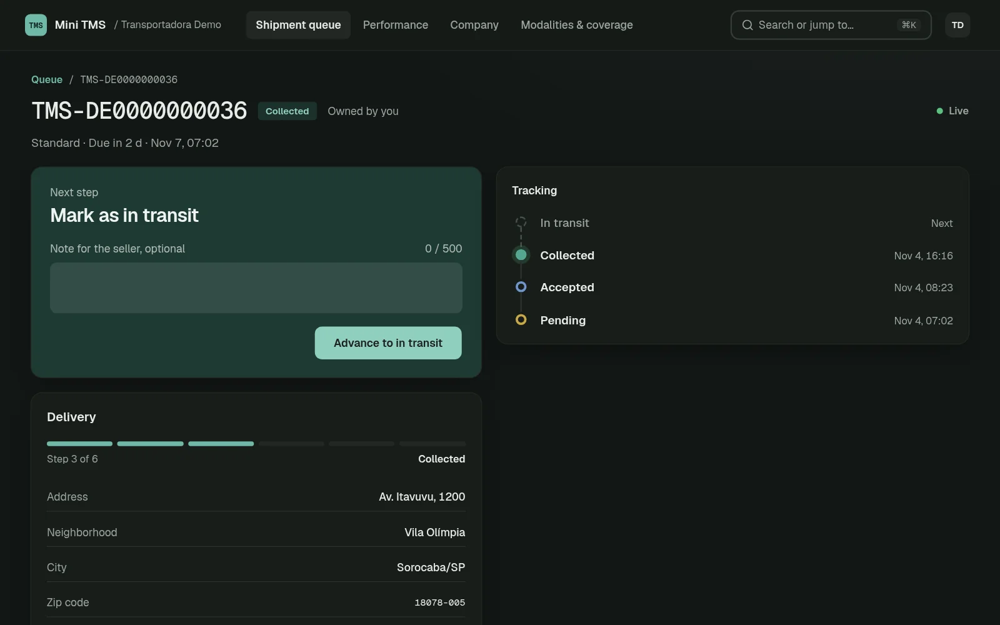
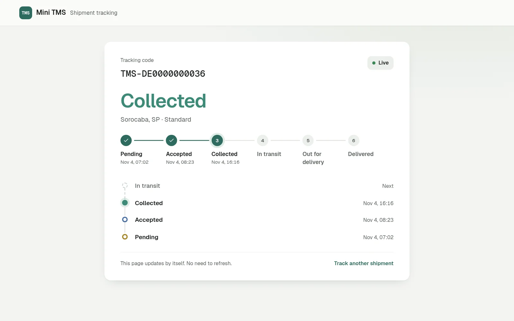
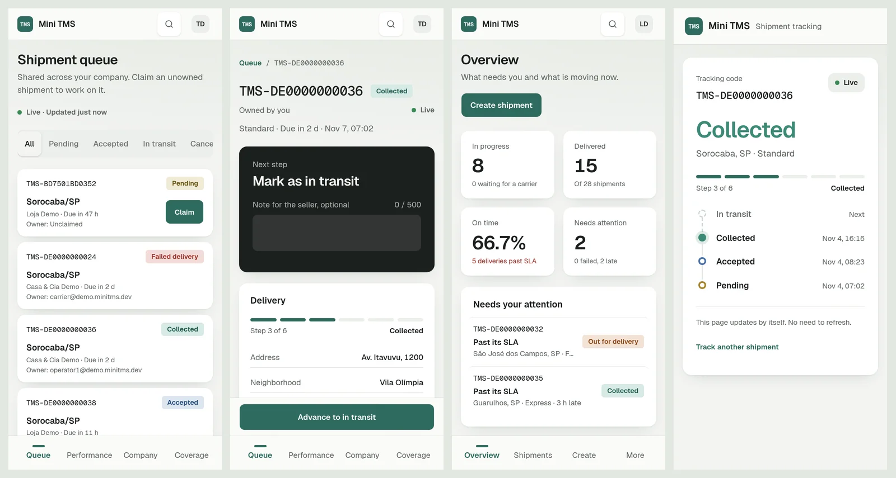
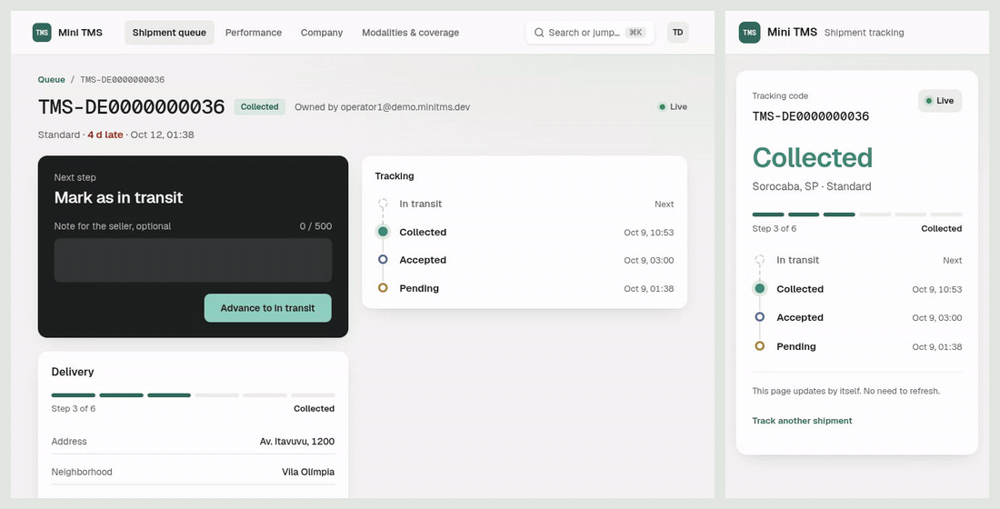
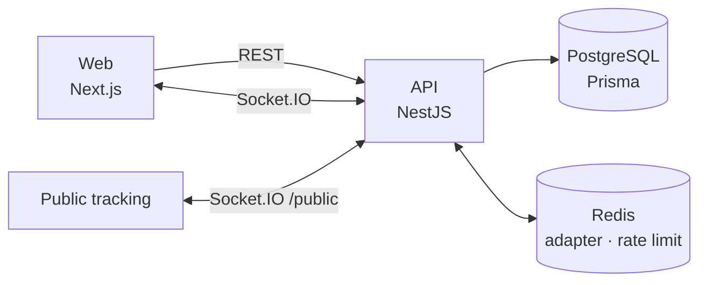

# Mini TMS

[](https://github.com/MGuerreiro42/mini-tms-logitrack/actions/workflows/ci-api.yml)
[](https://github.com/MGuerreiro42/mini-tms-logitrack/actions/workflows/ci-web.yml)
[](./LICENSE)

Multi-tenant transportation management system. Sellers ship, carriers deliver, and everyone, including the end customer, follows each shipment live.

**[Live demo](https://mini-tms-logitrack.vercel.app/login)**: sign in as a seller, carrier or operator in one click. Demo shipments move on their own while you watch, and the data resets every night.



<sub>The seller overview with no interaction: new updates land in the feed and the counters follow.</sub>

## Features

**Sellers**
- Create shipments in three steps: destination and modality, a carrier that covers it, review
- Overview for a 7/30/90-day window: active, late, on time and delivered tiles that open the matching list, a pipeline of open stages, exceptions and live activity ([spec](./specs/07-dashboards.md))
- Shipment list with views and counts (Active, Exceptions, …), search, one risk phrase per row, a peek sheet and bulk copy/cancel ([spec](./specs/06-tables-and-search.md))
- Integrations: signed webhooks with retries, a live test inbox and delivery log with replay, and API keys for the public API

**Carriers**
- Shared queue with Mine/Unclaimed/On the road views sorted by urgency, owners by name and Claim next; operators move shipments step by step, with notes for the seller
- Failed delivery and return flows behind confirmation
- Performance for a window: on time, median delivery, first attempt and claim time, median and p90 per stage against a budget, and the team by name
- Own coverage areas (whole states or specific cities) and modalities

**Admins**
- Approve or reject seller and carrier sign-ups
- Demo card on the overview: reset the demo, and start Chaos Mode (failed-delivery storm, carrier outage or webhook endpoints down) that every signed-in visitor sees as a banner with a countdown ([spec](./specs/08-demo-showcase.md))
- Overview with a live platform pulse (events, sockets, simulator, webhooks, queues, Postgres and Redis), platform tiles and on time per carrier
- Seller 360 and Carrier 360 pages with the tenant's own numbers, and 30-day scorecards on both lists
- Platform-wide monitoring with views per status, search and a peek, filterable by seller and carrier, updated live; overview tiles open the matching list

**Everyone**
- Public tracking page per shipment, live over WebSocket
- Live delivery map: the vehicle moves along the street route; seller and carrier see it to the door, the public link only up to the destination city ([spec](./specs/03-live-map.md))
- A sidebar grouped by task with live counts on the views that need action, a collapsible rail, recent shipments, a live-ops footer, `g`-key shortcuts and a phone sheet ([spec](./specs/09-app-sidebar.md))
- `⌘K` command menu (pages, views, recent shipments and tracking codes), light and dark themes, full mobile layout

## Screenshots

<table>
  <tr>
    <td></td>
    <td></td>
  </tr>
  <tr>
    <td align="center"><sub>Seller overview</sub></td>
    <td align="center"><sub>Carrier shipment detail</sub></td>
  </tr>
  <tr>
    <td></td>
    <td></td>
  </tr>
  <tr>
    <td align="center"><sub>Admin monitoring</sub></td>
    <td align="center"><sub>Carrier performance</sub></td>
  </tr>
  <tr>
    <td></td>
    <td></td>
  </tr>
  <tr>
    <td align="center"><sub>Dark theme</sub></td>
    <td align="center"><sub>Public tracking</sub></td>
  </tr>
</table>





<sub>A carrier advances a shipment (left); the public tracking page (right) updates with no refresh.</sub>

## Architecture



- **Multi-tenant RBAC** in layers: global role, company membership (manager/operator) and per-resource ownership, enforced in guards and queries.
- **Carrier matching:** a shipment can only go to an approved carrier that covers the destination city or state and offers the chosen modality.
- **Real-time:** status changes fan out to seller, carrier and shipment rooms. The Socket.IO Redis adapter keeps it correct across multiple API instances; public tracking runs on its own unauthenticated namespace.
- **SLA** derived from creation time and modality (`dueAt`), no extra state to keep in sync.

The reasoning behind each decision is in [`DESIGN.md`](./DESIGN.md).

## Tech stack

| | |
|---|---|
| **API** | NestJS 11, Prisma 7, PostgreSQL 16, Redis 7, Socket.IO, JWT |
| **Web** | Next.js 16 (App Router), React 19, TanStack Query, Tailwind CSS 4, shadcn/ui |
| **Testing** | Vitest (unit + e2e on real Postgres and Redis), Testing Library, MSW |
| **Tooling** | pnpm, Biome, lefthook, commitlint, GitHub Actions (CI, CodeQL, gitleaks) |

## Getting started

Requires Node 24, pnpm 11 and Docker.

```bash
pnpm install                       # root: git hooks only
docker compose up -d               # Postgres + Redis

cd apps/api
cp .env.example .env               # matches docker-compose; seeds the demo data
pnpm install
pnpm exec prisma migrate deploy
pnpm exec prisma db seed
pnpm start:dev                     # http://localhost:3333

cd ../web
cp .env.example .env.local
pnpm install
pnpm dev                           # http://localhost:3000
```

Demo accounts (local seed only):

| Role | Email | Password |
|---|---|---|
| Seller | `seller@demo.minitms.dev` | `demo12345` |
| Carrier manager | `carrier@demo.minitms.dev` | `demo12345` |
| Carrier operator | `operator1@demo.minitms.dev` | `demo12345` |
| Demo admin (never decides sign-ups) | `admin@demo.minitms.dev` | `demo12345` |
| Admin | `admin@minitms.dev` | `admin12345` |

With `NEXT_PUBLIC_DEMO_LOGIN=true` (on in `.env.example`) the login page signs in as seller, carrier manager, operator or demo admin in one click, and every app shows the Chaos Mode banner.

With `DEMO_SIMULATOR=true` (on in `.env.example`) the demo carrier and sellers act on their own while anyone is connected, and the demo data is restored to the seed every night ([spec](./specs/01-demo-simulator.md)).

Tracking codes like `TMS-DE0000000040` open at `/track/<code>` without signing in.

## Webhooks

A seller's endpoint (set under Integrations) receives a `POST` for `shipment.created` and `shipment.status_changed`:

```json
{
  "type": "shipment.status_changed",
  "timestamp": "2026-11-04T15:00:00.000Z",
  "data": { "shipmentId": "…", "trackingCode": "TMS-…", "status": "IN_TRANSIT", "previousStatus": "COLLECTED" }
}
```

The endpoint must be an `https` URL on a public address; redirects are not followed. Requests are signed per [Standard Webhooks](https://www.standardwebhooks.com/) with the endpoint's `whsec_…` secret: headers `webhook-id`, `webhook-timestamp` and `webhook-signature`. Any official library verifies them; pass the raw body, not re-serialized JSON (in Express, `express.raw({ type: 'application/json' })` on the route):

```ts
import { Webhook } from 'standardwebhooks';

const wh = new Webhook(process.env.WEBHOOK_SECRET!); // whsec_...
const event = wh.verify(req.body, req.headers as Record<string, string>); // throws if invalid
```

A non-2xx answer, a timeout (5 s) or a network error is retried after 10 s, 30 s, 90 s, 270 s and 810 s; then the delivery is marked failed and can be replayed from the delivery log. A replay is a new delivery with a new `webhook-id`. Delivery is at-least-once, so deduplicate on `webhook-id`. Every seller starts pointed at a built-in test inbox that shows each request live with its signature check, and can fail on purpose to watch the retries.

## Public API

Create an API key under Integrations, then create and read shipments from a script. `shipment.json` takes the same fields as the seller's create flow; `modalityId` and `carrierId` come from the seller app (an enabled modality and a carrier eligible for the address):

```json
{
  "addressStreet": "Av. Paulista",
  "addressNumber": "1000",
  "addressNeighborhood": "Bela Vista",
  "addressCity": "São Paulo",
  "addressState": "SP",
  "addressZipCode": "01310-100",
  "modalityId": "…",
  "carrierId": "…"
}
```

```bash
API=http://localhost:3333
KEY=$(uuidgen) # reuse it when retrying this request

curl -X POST "$API/v1/shipments" \
  -H "X-Api-Key: tms_..." \
  -H "Idempotency-Key: $KEY" \
  -H "Content-Type: application/json" \
  -d @shipment.json
```

Repeating an `Idempotency-Key` (per API key) within 24 h returns the first successful response with `Idempotent-Replayed: true`; while the first is still running you get `409`; a different body gets `422`; a failed request releases the key. `GET /v1/shipments?status=&page=&limit=` (default 20, max 100) and `GET /v1/shipments/:id` read them back. Each key may make 120 requests per minute. All routes are documented at `/docs` on the API.

## Testing

```bash
# apps/api
pnpm test          # unit
pnpm test:e2e      # needs E2E_DATABASE_URL pointing at a database ending in _e2e

# apps/web
pnpm test
```

CI runs lint, build and tests for both apps on every pull request, with real Postgres and Redis for the API e2e suite.

## Deployment

- **Web** on Vercel: root directory `apps/web`, `NEXT_PUBLIC_API_URL` set to the API, `NEXT_PUBLIC_DEMO_LOGIN=true` where the API seeds the demo.
- **API** on Railway: root directory `apps/api`. WebSockets need a long-running process, so not serverless. Build, start, healthcheck and pre-deploy (migrations + seed) are versioned in `apps/api/railway.json`. Per environment: Postgres and Redis add-ons, `JWT_SECRET`, `CORS_ORIGIN`, `TRUST_PROXY` (number of proxies in front of the API; required in production) and `ADMIN_PASSWORD`. `SEED_DEMO=true` only where the public demo accounts belong. `DEMO_SIMULATOR=true` alongside it to keep the demo moving and reset it daily.

## Project structure

```
apps/
├── api/   NestJS: modules per domain (auth, sellers, carriers, shipments, tracking…)
└── web/   Next.js: app routes, feature folders, shared components
```

The two apps are independent pnpm projects. Open [`mini-tms.code-workspace`](./mini-tms.code-workspace) in VS Code so each resolves its own `tsconfig.json`.

More docs: [`DESIGN.md`](./DESIGN.md) (architecture, data model, decisions), [`SCREENS.md`](./SCREENS.md) (screen specs), [`FLOW.md`](./FLOW.md) (end-to-end flow).

## Roadmap

Operator invites, email and SLA-breach notifications, rule-based assignment. See [`DESIGN.md` § 7](./DESIGN.md#7-roadmap-advanced-features--next-steps).

## License

[MIT](./LICENSE)
